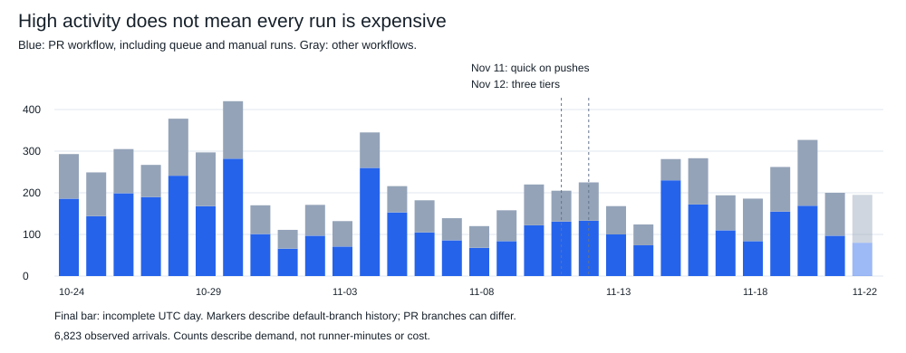
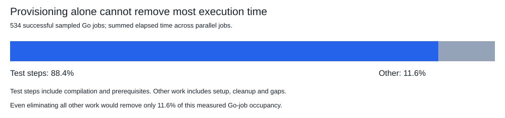
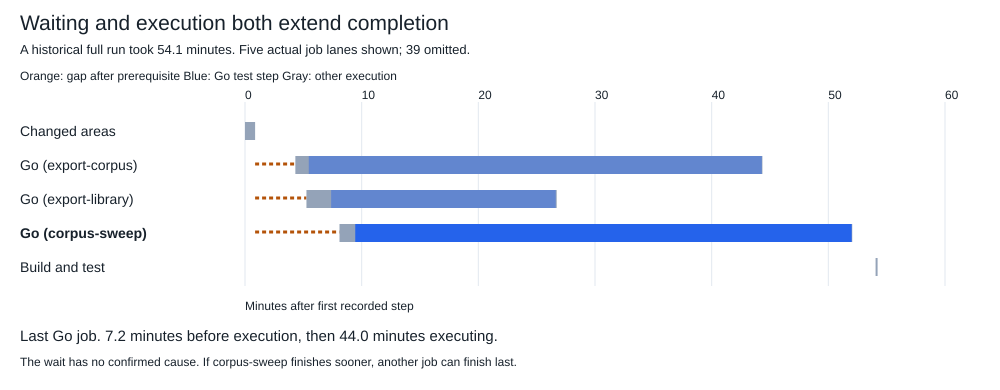
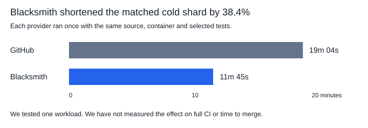

# OpenSysML CI findings and runner tests

23 November 2026

## Executive report

### Are we waiting for GitHub to provide machines?

**Sometimes jobs wait, but we do not know whether a shortage of machines causes it.** CI usually began within seconds in our sample. Later test jobs had a typical wait of about 3.5 minutes, with one waiting about an hour. GitHub's scheduling also contributes to these gaps, so we cannot blame all of that time on unavailable machines.

### Would our VPS make CI faster?

**Our VPS did not make the tested work faster.** It took about 21 minutes, even after reusing some previous setup. GitHub completed the same work in about 19 minutes in a separate test. The conditions differed, and our VPS also runs other services. We have no reason to replace GitHub with this VPS for speed.

### Would Blacksmith make CI faster?

**It made the test we compared faster.** Blacksmith took about 12 minutes where GitHub took about 19 minutes, a saving of **38%**. Both completed the same checks successfully. Another Blacksmith run took a similar time. We have not shown that the whole CI process or time to merge would improve by 38%.

### What would it cost?

**The machine we tested costs $0.008 per minute.** Blacksmith's monthly free allowance covers **1,500 minutes on that machine**, enough for about 100 jobs lasting 15 minutes each. Setup time and unsuccessful jobs use the allowance too.

Moving everything could cost **roughly $4,000 to $6,500 per month** under our earlier workload estimate. That estimate is unverified, and the lower figure assumes the measured speed improvement applies everywhere. **These figures illustrate the possible cost; they do not predict our bill.** Extra storage and taxes are excluded.

### How could we keep the cost down?

**Keep most CI on free GitHub machines.** Use Blacksmith only for selected slow jobs or urgent changes. A monthly budget of 1,200 minutes would leave room below the free allowance. We would need to track usage and switch back to GitHub before reaching the limit.

We can also apply for open-source sponsorship from Blacksmith or Namespace. Improving slow tests and avoiding unnecessary repeat runs would reduce work on any provider.

### What takes the longest?

**Running the Go tests takes most of the machine time we measured.** Test steps used **88%** of the time across successful Go test jobs. This includes preparing the code to run. Machine setup and other work used the remaining 12%.

The slowest checks involved exporting models and checking large collections of examples. Waiting for jobs to start also delayed some runs. These figures describe the Go test jobs, not every workflow or the whole time a pull request takes to merge.

**Our recommendation is to keep GitHub, improve the slow tests, and consider Blacksmith for selected jobs or through sponsorship.** More provider tests are paused. The detailed report below contains the measurements and supporting evidence.

## Detailed report

### How often CI runs

We counted 6,823 workflow runs created between October 24 and the November 22 collection. The count includes every workflow type, outcome and trigger event. Collection ended before November 22 finished in UTC, so the final day is incomplete.

| Workflow category | Observed runs |
| --- | ---: |
| PR workflow, including PR, merge-group and manual events | 4,158 |
| Documentation deployment | 864 |
| WebAssembly cache | 706 |
| Action validation | 598 |
| Pilot-validator cache | 182 |
| Other workflows | 315 |
| Total | 6,823 |

Each workflow counts once, whether it updates a cache, publishes a release or runs a large test matrix. Parallel jobs reduce waiting by using more machines at once. Their execution times add to total compute use.

GitHub reported multiple attempts for 617 runs. Their attempt numbers imply 834 additional attempts. GitHub can retain successful executions under new job IDs when a run repeats. We corrected 20 records that otherwise counted the same execution twice.

An earlier audit estimated 817,000 runner-minutes per month. We have not verified that estimate, and CI changed during the period. We use it below to illustrate costs, not to forecast a bill.

The collection protocol, sampling manifest and raw records are retained separately and available on request.

### Where time goes

We selected 240 runs with a fixed random seed and requested all 265 numbered attempts. GitHub returned job records for 214 runs, with 238 attempts and 2,635 records. We did not assign durations to missing intervals. The figures below describe this sample.

| Measurement | Observed result | Interpretation |
| --- | --- | --- |
| Initial PR-workflow startup | Median 10 seconds across 53 first attempts; maximum 10m 13s | Initial startup was usually quick. |
| Go-job start after its prerequisite finished | Median 3m 32s across 542 source-verified jobs; maximum 60m 39s | Some jobs waited several minutes. This includes GitHub scheduling and runner acquisition. |
| Elapsed time across successful Go jobs | 7,508 summed minutes across 534 jobs | Times are added across parallel jobs. |
| Time inside Go test steps | 6,636 minutes, or 88.4% | Compilation and Make prerequisites are included. |
| Other Go-job time | 872 minutes, or 11.6% | Includes provisioning, checkout, cleanup and gaps. Some of this work is required. |

#### How one full CI run completed

This full-tier run took about 54 minutes after its first recorded step. The chart shows five jobs and emphasizes the last Go job to finish. The full timeline shows all 44 recorded job intervals. Orange marks the gap after Changed areas finished. Blue marks the Go test step, including compilation. Gray marks other time within the job. We omitted records without complete execution intervals. This example does not establish the duration of a typical run.

[Open the full-size timeline with job links](team-report-timeline.html).

Logs identify library and export round trips, API-JSON writer sweeps, structure and property comparisons, and `TestExamplesSweep` as profiling targets. Some individual tests took tens of minutes. Nested and parallel test durations overlap. Adding them would overstate the time a change could save.

Corpus setup, solver installation and network failures account for some delay. Test steps took more time in the sample. On the VPS repeat, testing began about four seconds after the shard command started. Completion still took almost 21 minutes. Preloading the container image would not remove that test time.

In another historical run, the last Go job to finish waited about 33 minutes, then ran for about 54 minutes. More runners may reduce that wait. The API does not establish its cause. If we speed up that job, another job can become the last to finish.

Several failures were code or generated-baseline defects. Additional runners cannot repair those failures.

The historical timing analysis, failure review and VPS logs are retained separately and available on request.

### What the runner experiments showed

We ran the export-library race shard with the same source revision and Go container image. It checks library graph round trips, identity preservation and repeated conversion. We did not run the full CI matrix.

| Observation | GitHub | Blacksmith | VPS |
| --- | ---: | ---: | ---: |
| First completed cold comparison | 19m 04s | 11m 45s | First cold run stopped at 20m, incomplete |
| Follow-up cold execution | Stopped at 20m, incomplete | 12m 17s | Not repeated cold |
| Warm or partially primed execution | Not completed | 11m 14s | 20m 55s |

Every completed execution passed **112 subtests and the parent test**. None failed or skipped. Interrupted runs did not produce a final test verdict.

#### Blacksmith shortened the workload we tested

The chart compares only the completed matched cold runs. Cache conditions differ in the VPS repeat, so the table does not rank all three providers on equal terms.

Blacksmith saved 7 minutes 19 seconds, or 38.4% of GitHub's shard time, in the first matched comparison. Its full job finished sooner too. The second Blacksmith cold run took 32 seconds longer than the first. The second GitHub control timed out. We cannot calculate its completed-runtime ratio.

Blacksmith's warm execution reached testing in about two seconds, versus 109 seconds cold. The package itself took longer to execute in the warm run. We therefore separate preparation savings from test execution.

The VPS had four AMD EPYC vCPUs and six existing demo containers. Its sampled memory use peaked around 4.1 GiB against a 10 GiB limit. It did not run out of memory, and it did not demonstrate a speed benefit. It was not an otherwise idle dedicated machine. Equal logical CPU counts do not establish equal hardware performance or contention.

Our first provider attempt failed before tests because we configured the container mount permissions incorrectly. We fixed the setup before the successful comparison. That failed attempt supplies no test-performance evidence.

The repeat study stopped after GitHub's timeout. Remaining export repeats and corpus-sweep trials did not run. We have not tested a full workflow, a burst of concurrent jobs or the effect on time to merge.

The experiment commands, source and container pins, test results and resource logs are retained separately and available on request.

### What Blacksmith would cost

The supplied Blacksmith export recorded $0.104 of nominal usage across the initial two jobs. Its dashboard showed 13 four-vCPU minutes consuming 26 of the 3,000 equivalent free minutes. The later screening added 24 rounded four-vCPU minutes, or 48 equivalent minutes. These are observations at different times, not a current invoice or live balance.

At standard published pricing, four-vCPU Linux costs $0.008 per minute. The monthly free allowance covers **1,500 actual four-vCPU minutes per organization**. Selected jobs can fit within that allowance. The earlier estimated workload cannot.

Using the unverified 817,000-minute monthly estimate, four-vCPU runners would cost approximately $6,524 with unchanged runtime, or $4,016 if the measured 38.4% reduction applied everywhere. That uniform improvement has not been demonstrated. Both scenarios include the free compute allowance and exclude add-ons and taxes. **They are not forecasts.**

Sources: [Blacksmith instance and allowance documentation](https://docs.blacksmith.sh/blacksmith-runners/overview), [pricing](https://www.blacksmith.sh/pricing). Published rates were checked November 23. Standard GitHub-hosted compute for public repositories remains the financial baseline.

### What we should do next

1. **Keep GitHub as the default.** Preserve the quick, queue and full test coverage. This four-vCPU VPS has not shown a reason to replace the GitHub runners.
2. **Profile export and structure comparisons and corpus sweeps** on the current source. Preserve the tests. Measure whether each change shortens the required workflow.
3. **Consider an optional Blacksmith run for export-library** when faster feedback is worth the cost. Track usage against a monthly budget. We have not changed production CI.
4. **Apply for open-source sponsorship** before broad paid adoption. Blacksmith has a sponsorship program, and Namespace sponsors GitHub Actions compute, caching and observability. Confirm project eligibility, allowance, concurrency, storage and renewal terms. No sponsorship is approved.
5. **Record job readiness and link runs to pull requests.** Record when jobs become ready, when execution starts and why work is cancelled. Sparse PR/run associations currently prevent a reliable division of PR-to-merge delay into CI, review, author changes and merge policy.

**Provider trials are paused.** This recommendation uses the completed matched trial and the historical analysis. Historical GitHub runs differ in commits, configuration and cache conditions. They provide context rather than extra matched controls.

Sources: [Blacksmith sponsorship announcement](https://www.blacksmith.sh/customer-stories/celery), [Namespace OSS program](https://namespace.so/opensource).

### Limits and checks

Blacksmith was faster for the workload we tested. We have not measured a project-wide speedup, a monthly bill, a reliability improvement or a reduction in time to merge.

Collection, arithmetic, test-name parity and retained evidence checks passed in the underlying studies. The research notebook executed and passed marimo checks. The repository documentation link checker has a separately recorded existing missing-license target. Full Go build, vet, format, application suites and a complete docs-site build were not run for this report.

The protocol, dictionary, sampling manifest, scripts, source revisions, logs and validation records are retained locally and available on request. This branch contains only the report and its charts. Upstream CI and local Git settings were not changed. Experimental workflow changes were confined to an isolated evaluation fork.
